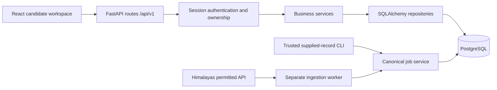

# Architecture: foundation, matching and advanced discovery

Phase 6 adds [Career Intelligence](career-intelligence.md) with one shared read-only analysis endpoint, no new schema and no replacement of the matching engine. Phase 5 adds [private resume intelligence](resume-architecture.md). Phase 4 adds [advanced discovery](search-architecture.md), [comparison and saved searches](job-comparison.md). Phase 3 adds the [deterministic matching module](matching-architecture.md). The Phase 1 modules remain operational. Phase 2 adds ingestion control, persistence, freshness and a separate worker; see [ingestion.md](ingestion.md) and [data-sources.md](data-sources.md).

The candidate workspace is a modular monolith with a separate frontend and API process. PostgreSQL owns identity, profiles, jobs, saves, applications and history. React displays server responses and never invents a successful write, vacancy, activity count or match score.

## Responsibilities

- `api/routes.py` defines HTTP contracts, pagination and UUID parsing; it calls business services.
- `api/schemas.py` validates input/output, unknown fields, lengths, dates, ranges, currencies and enums.
- `api/dependencies.py` resolves the logged-in user from the revocable server-side session, never a client-supplied user ID.
- `services/candidates.py` handles profile/child writes, preferences and minimal audit events.
- `services/jobs.py` stores canonical records through a trusted operator interface, enforces source identity, searches and manages saves.
- `services/applications.py` owns application creation, conflict checking, status corrections and atomic event creation.
- `db/repositories.py` handles ownership-scoped reads and stable pagination. Models hold database constraints.
- `db/session.py` owns each request transaction. Function-scoped dependencies commit **before the HTTP response is sent**; any exception rolls back the unit of work.
- `services/overview.py` calculates actual counts, field completion and recent application history from persisted records.

No empty microservice scaffolding, distributed workflow engine, scraping engine or AI provider is included. Phase 2 uses a small PostgreSQL-backed ingestion queue and an explicitly started optional scheduler/worker.

## Identity and ownership

Passwords use Argon2. The browser holds a random HttpOnly, SameSite=Lax session cookie; PostgreSQL stores a SHA-256 token digest and expiry. Sign-out deletes the session row. Authentication loads the user server-side and resolves its unique candidate profile.

Candidate skill, experience, education, save and application operations scope every query to that profile. Application details and event history join back to the authenticated user; missing and unauthorized resource IDs both return 404. Attempts to submit `user_id` in profile data are rejected. Global canonical job records are readable by signed-in candidates; only the trusted local operator CLI/service may write them.

Origin validation, cross-site fetch metadata and SameSite cookies protect browser mutations. Vite's local proxy preserves the browser origin. See [security.md](security.md) for deployment limits.

## Saves and applications

Saving uses PostgreSQL `INSERT ... ON CONFLICT DO NOTHING` under a unique `(profile_id, job_id)` constraint. Unsave touches only the current candidate's relationship. Saves are independent of applications.

Applications have seven supported statuses. Any initial status is allowed because candidates may import existing progress. Active states can move freely to capture legitimate real-world paths. Changing an outcome (`offer`, `rejected`, `withdrawn`) requires a correction reason. Notes/date edits do not create invented status events.

Creation writes the application and initial event in one transaction. Updates lock the application row, compare the required `expected_version`, write any status event, then commit the current status and history together. SQLAlchemy's version column adds a second concurrency guard. Stale writers receive 409; no duplicate event is emitted. One application per candidate/job keeps the tracker unambiguous; repeat applications for a later hiring cycle need a future explicit design.

## Source and future intelligence boundaries

`modules/sources/contracts.py` defines typed pages, normalization, stable identity and verification. `HimalayasAdapter` implements the network boundary. Sources also store the adapter reference, page budget, optional schedule and cooldown. Availability checks are separate from observations; source outages do not close or expire listings.

`store_job` retains manual import behavior and refuses to overwrite an integrated source. Phase 2's observation writer uses the same source/external uniqueness constraint with conflict handling, row locks and conservative partial updates. It records probable cross-source duplicates without merging. Publication, source modification/deadline, first/last seen, verification and material update remain distinct.

`services/intelligence_contracts.py` retains historical future-service protocols; the implemented resume module owns its concrete parsing/review contracts. These future integration protocols remain separate from the implemented deterministic matching module. No embedding database or external model calls are operational. Canonical profile/job schemas now feed versioned matching; see [methodology](matching-methodology.md). Resume metadata and private storage are implemented in the dedicated Phase 5 module. The optional legacy application reference remains opaque and grants no document access; no automatic application-document attachment or submission is added.

## Frontend

React Router defines Overview, Profile, Discover, Recommendations, Job Details, Data Sources, Saved Jobs, Applications and Settings. TanStack Query owns HTTP query/mutation state and invalidates relevant queries after confirmed successful writes. Loading, empty, failure, retry and saved feedback are explicit. Search filters are encoded in the URL; pagination queries the backend. Applications preserve the expanded record in the URL and display persisted event history. Reusable controls have labels, keyboard focus and reduced-motion support. A mobile navigation drawer supports smaller screens.

## Validation and operations

Alembic creates tables explicitly; startup never calls `create_all`. Readiness checks the database and expected migration revision. Liveness is independent. Errors use a predictable envelope and suppress internal exception details and validation input values.

API integration tests run against a migrated isolated PostgreSQL database with real authentication. Browser tests use a second disposable database and synthetic records clearly marked TEST ONLY. Frontend unit tests mock HTTP deliberately; they are not evidence of a real source integration. Current results are in [phase4-validation.md](phase4-validation.md); Phase 1–3 reports remain historical. [validation.md](validation.md) preserves historical Phase 1 evidence.
