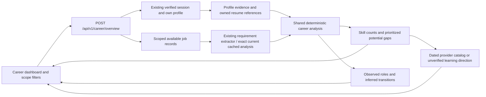

# Career Intelligence architecture and interpretation

Phase 6 extends the existing modular monolith. React/TypeScript/TanStack Query presents one shared FastAPI analysis response; SQLAlchemy reads existing profiles, preferences, owned resume decisions and canonical jobs. It does not create a second candidate system, write profile qualifications, change the Phase 3 matching formula, calculate private matching assessments or require an external AI provider. No database schema change, new migration, infrastructure or package dependency is needed; Alembic head stays `0005_resumes`.

## Data flow and module boundaries

`modules/career/evidence.py` classifies skill evidence and outputs only owned record references, not raw private resume text. `service.py` scopes/retrieves jobs and computes the whole response at one as-of time; it reuses exact current `JobRequirementAnalysis` entries only when job/content/extractor fingerprints agree, otherwise calling the existing pure extractor without persisting a new cache row. `analysis.py` owns reusable title normalization, conservative deduplication, counts, priorities and role ranking. `resources.py` matches gaps to the checked catalog in `app/data/career-resources.json`. `schemas.py` defines typed request/response contracts. `api/career.py` uses existing session dependencies. `features/career/` renders the six linked sections, evidence disclosures, scope controls and staged transition list.

## Candidate evidence and privacy

| Status | Meaning | Role overlap / gap policy |
|---|---|---|
| Confirmed | Candidate-recorded structured skill; includes an explicitly applied resume skill | Used as recorded evidence, never described as independent verification |
| Resume-evidenced / documented | A structured technology in recorded employment, or an unconfirmed owned resume skill proposal | Recorded employment technology is usable evidence; unconfirmed resume proposals are not used for role overlap |
| Inferred | Existing matching extraction finds a skill mention in recorded profile summary, project, qualification, certification or employment text | Usable as explicitly labeled inferred evidence; no proficiency is invented |
| Not evidenced | No available skill record supports it | Describes the available records, not demonstrated inability |

Rejection removes an unconfirmed proposal from career evidence. Accepting without applying remains unconfirmed. A gap backed only by an unconfirmed resume suggestion prompts review/confirmation first rather than assuming a learning deficit. Existing direct or inferred profile evidence is not silently turned into a gap for that same skill. Confirmed resume references are joined only to the authenticated profile and only when the current skill ID and normalized name agree with the applied target. Deleting a document removes its evidence references but retains independently stored profile skills, following Phase 5 retention rules.

Candidate responses contain skill names and record paths/IDs, review status and, for transitions, the necessary occupational title. They omit candidate identity/contact fields, employer names, raw summaries, private resume text and source excerpts. Public listing requirement excerpts remain available with exact job ID, category and source span. Career endpoints accept no user/profile ID; a candidate cannot select another user's evidence. Confirmation and profile editing continue exclusively through the existing workflows.

## Population, filters and denominators

Eligibility here means **data eligibility**, not hiring eligibility. SQL retrieval reuses `visible_job_condition(now)` and additionally excludes closed/expired records and elapsed source deadlines. Integrated listings require existing recent verification; stale source records are not freshened. Manual/legacy listings retain existing discovery behavior and are labeled availability-unverified. No live source is contacted by analysis.

Filters support a target title, literal listing-location substring, source UUID, inclusive timezone-aware `published_after`, exclusive `published_before`, required/preferred/all skills, and a selected origin occupation. The frontend uses explicit UTC day boundaries. Missing publication dates are excluded by publication filters; modification dates are never relabeled as publication. Location strings are not mapped to nationality, a verified region or work authorization.

For a target title, every normalized target token must occur in the job title. Existing role aliases and stopwords are reused, while unknown technology/domain tokens are retained to avoid equating Java with JavaScript or medical with financial work. If no explicit filter exists, saved preference target titles are used. If no titles are saved, initial relevance requires at least one required/preferred skill overlapping recorded profile evidence; unconfirmed resume suggestions cannot establish this population.

Exact employer/title/location/content duplicates are counted once, conservatively using the existing job input snapshot. Alias-equivalent source wording, probable near-duplicates and differently recorded copies may remain distinct; identical separate vacancies may be merged. Duplicate exclusions are shown. No duplicate count is a claim of perfect real-vacancy entity resolution.

The denominator is **all distinct relevant listings in the examined eligible population**, including relevant listings with no recognized required/preferred skills. The usable-requirement count is shown separately. Each normalized skill is counted at most once per listing. Required/preferred classification uses the existing extractor's strongest category; a preferred mention is not upgraded merely because the skill is popular. Incidental descriptions, negated requirements and ambiguous alternatives retain the existing extractor semantics and are excluded from mandatory/preferred counts. Sources, literal locations and publication-range/unknown-date counts describe this same denominator. Changing the requirement-category filter changes the numerator/category set, not the listing denominator. A zero denominator produces no skill statistics or fabricated percentages.

Analysis is bounded to 500 scoped records, ordered by most recently verified then stable job ID. When the eligible population is larger, the response exposes total scoped records, examined records, partial-population status and limitations. Every denominator then describes that examined subset, not all eligible records. Narrow filters before drawing conclusions; filtering a target title happens after this bounded retrieval, so rare targets outside the examined subset can be omitted. Requirement excerpts/listing examples are limited to 20 per skill or role while counts cover the complete examined population. Additional qualification/experience/credential examples are capped at 20; inspect actual listings for all wording.

These counts describe collected listings from the represented sources, not the whole labor market. No national representativeness, statistical significance, growth trend, salary movement or time-series inference is asserted. Geographic and publication filters allow examining separate scopes; no unsupported comparative trend is generated automatically.

## Gaps, roles and paths

Potential gaps are ordered by required-listing count, then total requesting-listing count, then normalized skill key for deterministic ties. The UI shows ordinal priority and the exact reason, denominator, required/preferred counts, supporting jobs and excerpts. This is a heuristic ordering, not a probability or an evaluated measure of employability. Shared context with existing skills supports investigation, not a technology-equivalence claim. `limited evidence` and `directional signal` describe sample support only: directional requires at least three supporting occurrences and at least five examined listings; these are explicit display thresholds, not calibrated confidence intervals.

Roles are actual collected titles grouped by conservative normalization. They require shared required/preferred skills with recorded profile evidence, so title similarity alone cannot recommend a role. Rank order uses overlap fraction of the group's distinct required/preferred skills, overlap count, listing support and stable title order. This career exploration heuristic is separate from—and does not change—the existing job matching score. Required skills without profile evidence are shown, along with source education, experience, credential/licensing and authorization requirements to investigate. Candidate satisfaction of those additional requirements is not asserted. Seniority variants can share a title group, so inspect individual listings.

Transitions connect an actual recorded employment title, or an explicitly selected title observed in the scoped listings, to an observed recommended destination. Transferable skills must intersect origin evidence, destination requirements and recorded profile evidence. Origin and destination listing/profile references are retained. Paths are labeled inferred relationships; no universally accepted route, standard duration, salary gain or promotion/hiring chance is invented. An empty intersection produces an insufficient-evidence state. No intermediate role is manufactured; this baseline does not assert a multi-hop sequence without supporting evidence.

The dashboard's role-discovery population is the broader scoped available sample; gap statistics and learning actions use the selected target-role population. This difference is stated next to results. Choosing **Use as target** recalculates gaps/learning for a suggested role. Changing the path destination only explores a transition and does not overwrite saved preferences. Updating saved target roles uses existing Settings.

## Learning-resource verification

The top 12 current gaps receive skill-specific actions linked to supporting job IDs. A recorded skill is not repeatedly prescribed beginner learning. A gap with unconfirmed resume evidence receives a review-first action. Other actions suggest comparing actual work, checking prerequisites and documenting relevant practice before choosing an introductory or advanced starting point.

Five resource destinations were opened and checked on 28 October 2026 and rechecked on 29 October 2026: [Python Tutorial](https://docs.python.org/3/tutorial/), [PostgreSQL Tutorial](https://www.postgresql.org/docs/current/tutorial.html), [TypeScript Handbook](https://www.typescriptlang.org/docs/handbook/intro.html), [React Quick Start](https://react.dev/learn) and [Docker getting-started index](https://docs.docker.com/get-started/). Catalog entries retain exact provider/destination, verification date/source, what identity/topics were checked and prerequisite/level notes. These are documentation resources, not fabricated course names, costs, credentials, enrollment or completion claims.

`verified` means the dated identity/content check is no more than 90 days old and is not future-dated. Older or future-dated entries become `verification_stale`, visibly requiring a destination check. This is an operational review interval, not a guarantee of live availability; links can change between checks. Resource checks do not run during dashboard requests. Skills without a checked catalog match receive an `unverified_suggestion` learning direction with no fabricated URL/provider/course. Verification never establishes employment outcomes or satisfaction of professional licensing requirements.

## Freshness, performance and API

`POST /api/v1/career/overview` requires JSON `CareerFilters` and the existing authenticated session. All filters are optional; unknown fields, invalid UUIDs, oversized fields, naive dates, reversed ranges and unknown origin titles are rejected. Missing profile/source yields 404; anonymous requests yield 401; database failures reuse safe generic errors. The response is `CareerOut`, with one input fingerprint and generation timestamp for all six sections. Source hashes/fingerprints, qualification evidence, filters, population and learning metadata participate in traceability. No persistent career result cache is stored and no stale matching result is reused as a fresh career assessment.

The dashboard uses one TanStack Query request per filter scope, with refetch on mount/focus and an explicit **Update career analysis** action. Profile mutations invalidate its query through the existing candidate-updated event. Navigation back after resume review refetches, so accepted/unconfirmed/applied state changes are observed. It is a point-in-time snapshot, not live streaming while a page is left idle; the timestamp remains visible. A short existing profile-row lock prevents concurrent manual/confirmation mutations from changing the shared profile input while analysis reads it. Only this endpoint uses a repeatable-read transaction, established before authentication queries, so all population counts, job rows, requirement caches and candidate inputs share one database snapshot even during concurrent ingestion. A later request recomputes from newer committed data. A conflicting concurrent profile write can require a safe retry through the existing database-error handler. The 500-record bound is for local reliability, not a production analytics pipeline.

No configuration keys, migrations or dependencies were added. Use existing local commands: backend `python -m pytest -q`, targeted `python -m pytest tests/test_career.py -q`, frontend `npm test`, `npm run build`, `npm exec prettier -- --check src e2e`, backend Ruff and `python -m alembic check`; from the project root run `scripts/browser-tests.ps1 -Python <venv-python>`. Tests guard separate `_test` and `_browser` databases. Additional career browser fixtures are seeded/cleaned through a narrowly scoped `_browser` helper so earlier workflows continue to see their original two listings.

See [completion and actual validation evidence](phase6-validation.md), [genuine data availability](phase6-genuine-dataset-evidence.json), and [database preservation](phase6-preservation-evidence.json). Production-readiness work, real-world extraction/career-quality evaluation, automatic alerts/applications, deployment and Phase 7–8 are outside this local phase.

The final concurrency verification commits job insertion, closure and requirement edits from a separate PostgreSQL session between the population-count and supporting-row queries. The current response retains its old snapshot and the next request sees the new one. A real division-by-zero failure verifies rollback/closure; pool checkout returns to zero, no idle-in-transaction session remains, and an ordinary connection retains READ COMMITTED isolation. These are database integration checks rather than an inference from ordinary unit tests.
