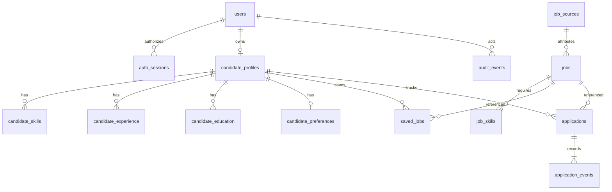

# Database

Current head: `0002_discovery`. The Phase 1 tables below are retained; Phase 2 adds three domain tables (17 total, plus Alembic metadata) and additive source/job/user fields.

PostgreSQL is required; no SQLite fallback is configured or claimed. The migration `0001_foundation` creates 14 domain tables plus Alembic's own version table. Column/default definitions are explicit in the migration; changing a model does not rewrite migration history.

| Table | Ownership and integrity |
|---|---|
| users | Unique normalized email; Argon2 password hash; UUID identity |
| auth_sessions | Token digest primary key; user foreign key; expiry index |
| candidate_profiles | Unique user foreign key; optional basic fields; JSON arrays for qualifications, certifications and project descriptions |
| candidate_skills | Profile FK; unique profile/normalized name; casefolded exact aliases only |
| candidate_experience | Profile FK; dates with check constraint; responsibilities, achievements and technologies |
| candidate_education | Profile FK; qualification, institution, optional field and dates; date check |
| candidate_preferences | Profile FK primary key; lists of roles/industries/locations/work/employment modes; nonnegative optional salary, currency, career level and nullable relocation |
| job_sources | Unique source name; disabled by default; sync/success timestamps; operational status; safe error code |
| jobs | Source FK; nullable external ID; unique source/external identity; salary/experience range checks; listing-status check |
| job_skills | Job FK; required/preferred check; unique job/normalized name/kind |
| saved_jobs | Candidate and job FKs; unique candidate/job pair |
| applications | Candidate and job FKs; unique candidate/job pair; constrained status; optimistic version; notes and dates |
| application_events | Application FK; from/to states, correction reason and actual event timestamp |
| audit_events | User FK, operation/resource reference, timestamp; no passwords, cookies, profile bodies or resume text |

IDs are UUID strings generated in the backend. PostgreSQL enforces foreign keys and unique constraints. Source identity intentionally permits NULL external IDs to coexist; title alone never merges vacancies. Required job fields are title, employer and description. Salary interval is optional because source values must not imply an annual amount when the period is unknown.

## Freshness

`published_at` comes only from supplied/source data. `first_seen_at` records insertion into this system. `last_seen_at` records actual delivery. `last_verified_at` is NULL unless explicitly supplied with evidence; reading or saving a record never sets it. `material_updated_at` identifies changes to canonical content. Jobs start with `status='unknown'`. Database existence does not prove the listing is open.

## Indexes

Frequent lookups index profile ownership, all candidate/job/application foreign keys, job source, job title, location, publication time, status and combined work/employment type. Application status and event time are indexed. Phase 1 keyword search uses parameterized PostgreSQL case-insensitive substring search with escaped wildcard characters. Full-text indexes and ranking are deferred until the dataset and Phase 2 requirements justify them.

## Transactions and concurrency

- Source/external identity and saved-job insertion use PostgreSQL conflict handling, tested under concurrent requests.
- Application writes use row locks and an expected version; stale updates return 409.
- Status and event history share the request transaction, including rollback if event persistence fails.
- Request transactions commit before sending success. Errors roll back; no schema is implicitly created.
- Profile/source/application creation races fall back to the unique constraint and the consistent 409 error envelope.

## Migration workflow

From `apps/backend`, run `python -m alembic upgrade head`, then `python -m alembic check`. The latter compares actual database metadata with SQLAlchemy models. For a new change, use `alembic revision --autogenerate -m <description>`, review the generated migration and test it on a disposable copy first. `downgrade base` drops the foundation tables and must be used only against an explicitly disposable database; it is not an application recovery procedure.

All timestamps are timezone-aware. Unknown scalar facts use NULL; absent collections use empty arrays without implying evidence that no skill or qualification exists. No document bytes, AI outputs or embeddings are stored in Phase 1.

## Phase 2 additive migration

`0002_discovery` preserves the existing tables/rows and adds:

- `users.is_operator`, non-null with server default false, so existing accounts gain no privilege.
- Source adapter reference, page budget, schedule interval/next run, last full walk and cooldown. Checks bound pages to 1–25 and schedule intervals to at least 24 hours.
- Job source modification/deadline, payload/description fingerprints, status evidence, full location/timezone restrictions and source categories. Expiry and description fingerprint have indexes.
- `ingestion_runs`: lifecycle, source FK, optional requesting-user FK, timestamps, cursors, page budget/checkpoints, counts and safe error code. A partial unique source index applies only to queued/running states. Check constraints enforce fetched/accepted accounting identities.
- `ingestion_records`: run FK, page/index, identity hash, optional job FK, outcome and safe code. Run/page/index is unique; run and identity hashes are indexed.
- `duplicate_candidates`: two job FKs, corroborating evidence code and timestamp, with one ordered relationship per pair. Records remain separate.

The isolated upgrade verification first created representative Phase 1 user/profile/source/job/save/application/event records under revision 0001, applied 0002, and verified that all seven persisted rows, relationships and the application note remained. Existing user operator access stayed false. See `phase2-migration-evidence.json`.

Run checkpoints and source-level locks are documented in [ingestion.md](ingestion.md). Diagnostics contain no complete raw payloads. Candidate data is never truncated by migration or source synchronization. Test fixture reset commands operate only on their explicitly guarded disposable databases.

## Phase 3 additive migration

`0003_matching` adds nullable `candidate_preferences.current_country`, public `job_requirement_analyses`, private `match_results` and private `matching_refreshes`. Input/version uniqueness, profile/job/analysis foreign keys, indexes and score/coverage bounds are explicit. No prior table is dropped or truncated. See [matching architecture](matching-architecture.md) for snapshot privacy, cache identity and retention. `phase3-migration-evidence.json` records a 0002-to-0003 isolated upgrade retaining nine representative foundation/discovery rows and their notes/source fingerprint. Live job IDs and source content were separately hash-checked unchanged.

## Phase 4 additive migration

Revision `0004_search` (file `89996b6a2f2b_advanced_search.py`) creates saved_searches with profile FK/cascade, per-profile normalized-name uniqueness, nonempty bounded name constraint, validated criteria JSON and timestamps; adds its ownership index and the jobs.last_verified_at index; and adds nullable job_context/assessment_day to match_results. Old match rows remain intact and conservatively require explicit search-context refresh. No original table/row is dropped or truncated in upgrade. The nullable context supports SQL freshness checks without changing scores or the Phase 3 formula. An unused employer index considered during development was removed from the final migration/model; no row data was affected.

The isolated 0003-to-0004 upgrade preserved 11 representative rows including source/job text, saves, application note/event, ingestion ledger and a legacy private match with null optional context. `phase4-migration-evidence.json` records the successful schema comparison. The live preservation check independently compared all 17 monitored original table counts/full-row SHA-256 inventories to the Phase 4 baseline after exact temporary-QA cleanup; source data and 80 job-analysis caches are unchanged. See phase4-data-preservation.json.

## Phase 5 additive migration

`0005_resumes` follows `0004_search` and creates resumes, resume_versions, resume_extractions, resume_proposals and resume_confirmations, with ownership indexes, cascading document FKs and uniqueness for versions/extraction reuse/proposals/idempotency. It adds nullable candidate_experience.is_current and candidate_education.completion_status with default unknown. No existing row is deleted or rewritten as a confirmed qualification. See [resume architecture](resume-architecture.md) for state/transaction semantics and the [populated migration evidence](phase5-migration-evidence.json). The independent [development preservation check](phase5-preservation-evidence.json) compares every original table's original-column values and counts with the captured Phase 5 baseline.

## Phase 6 read-only reuse

Career Intelligence reuses existing profile, resume-proposal/target provenance, jobs and exact current cached analyses. There is no new table or migration and no persistent career result cache. Head remains 0005_resumes. A fresh source fingerprint is calculated for each response. [Preservation evidence](phase6-preservation-evidence.json) compares every original column/value/count across all 26 tables with the pre-Phase-6 baseline. Nonempty profile/resume/application cases also remain covered by all Phase 1–5 integration/browser regressions in isolated databases.

## Phase 7 additive revision 0006_automation

New tables: job_events, alert_subscriptions, notification_preferences, application_reminders, automation_tasks, notifications, notification_outbox, notification_attempts, automation_heartbeat. Existing jobs gain event_sequence; ingestion_runs gain attempt_number/root_run_id/retry_at/retry_spawned. Applications gain a composite unique ownership key referenced by reminders. Durable unique keys protect job version events, logical notifications, channel outbox rows, numbered attempts and tasks. Existing tables/data are not recreated. See phase7-migration-evidence.json for a populated 0005 -> 0006 -> 0005 -> 0006 roundtrip, including saved jobs/searches, application history, matching and private resume metadata.
