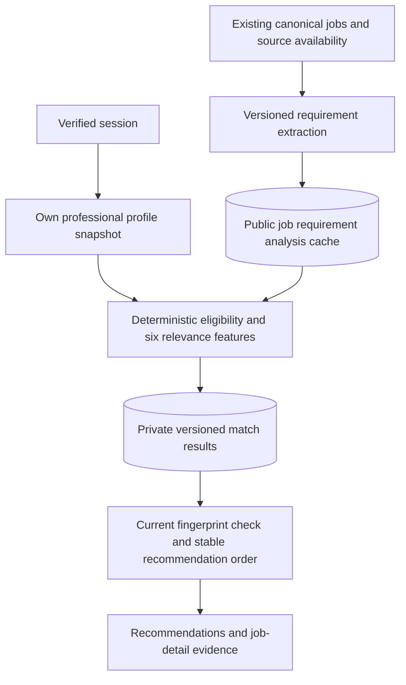

# Phase 3 matching architecture

The existing FastAPI/PostgreSQL modular monolith now includes `app/modules/matching`. React requests persisted assessments; reading a recommendation never silently calculates a score. Source ingestion, candidate editing, saves and application history keep their existing boundaries.

## Responsibilities and persistence

`skills.py` owns conservative aliases; `candidate.py` derives explicit/recognized professional evidence; `requirements.py` extracts requirements with exact source spans. `eligibility.py` handles source availability and explicit constraints as individually labeled checks. `features.py` computes relevance components and separate coverage; `engine.py` combines applicable components and creates grounded explanations. `service.py` owns refresh transactions, cache lookup, fingerprints and candidate-scoped queries. `evaluation.py` is an offline diagnostic and does not insert fixtures into application storage.

Migration `0003_matching`, after `0002_discovery`, adds three tables and nullable `candidate_preferences.current_country`. `job_requirement_analyses` stores a public source snapshot and extraction JSON, unique on job/content fingerprint/extractor version. `match_results` stores private professional input snapshots, analysis FK, candidate/job/config fingerprints, ranking version, nullable score, eligibility, coverage, assessment JSON and generated time. A unique input tuple prevents duplicate assessments. `matching_refreshes` records actual counts, completion/partial state, continuation and safe failure codes. All three tables have relevant foreign keys/indexes; score and coverage have database bounds. Private rows cascade with their candidate; public analyses cascade with the job. Old versions remain until an explicit future retention/deletion policy is implemented.

## Refresh and invalidation

Authenticated `POST /api/v1/matches/refresh` is synchronous and commits before returning success. It accepts a batch limit of 1–200, optional at most 200 job UUIDs, or an `after_job_id` cursor. A candidate-specific PostgreSQL transaction advisory lock rejects overlapping work with 409. A bounded run can be partial because more jobs remain or a job has invalid input/output; the response distinguishes these cases. Known per-job validation failures use savepoints. Unexpected database errors roll back the entire request and expose a safe 503 envelope; previous results are never marked freshly calculated.

Candidate fingerprints include skill, experience, education and preference child content and private child IDs, qualifications, certifications, projects and professional text. Name, account identity, employer/school identity and resume-upload state are excluded. Job fingerprints include canonical requirements/content, restrictions, salary/work mode, source identity, status, verification, expiry and UTC assessment day. Source `last_seen_at` alone does not invalidate a match. Configuration identity includes the full manifest fingerprint; extraction/taxonomy changes require their explicit versions to change.

Every read recomputes current fingerprints. Old assessments are hidden by default and explicitly labeled when requested. A reverted profile may reuse a historical result only if the entire candidate/job/config/date tuple matches current input and source availability is still valid. A changed job or clock prevents reuse even when the candidate fingerprint reappears. Tests cover edits/deletions/reverts of child records and concurrent refreshes. Query results prefer the exact current tuple over a later stale result, then sort by current-before-stale, assessable-before-null, descending score and job UUID.

## API and UI

`GET /matches` is paginated and supports minimum score, eligibility, required-skill evidence coverage, source, location, employment type, work arrangement and opt-in previous assessments. `GET /matches/{job_id}` and `/jobs/{job_id}/match` return not-calculated/current/stale without calculating. `GET /matching/status` returns actual counts, configuration and last refresh. All paths are under `/api/v1`; identity comes only from the session. No client candidate ID is accepted. Global job endpoints never include candidate snapshots or matches.

The Recommendations screen exposes refresh/continuation, filtering, source-attributed job cards and existing save actions. Job Details exposes assessment, evidence, unknowns, eligibility and component breakdown. Overview previews already calculated results. Successful profile mutations invalidate matching queries; screens recheck on mount and avoid showing cached results as current during a refetch.

## Operational boundary

No external model, embedding service, new paid dependency or resume pipeline is involved. Refresh work is bounded. List/status reads still inspect the candidate's stored job set in memory and need database-side filtering/pagination or materialized current-result indexing before large-scale deployment. Snapshot retention, distributed quotas, background matching and observability remain future work. Existing source freshness rules still apply; matching does not verify jobs through a fresh network request.
