# Phase 5: Resume intelligence

This extends the existing React/FastAPI/PostgreSQL modular monolith. Authentication, candidate services, skill aliases and the Phase 3 matching formula are reused. Upload and extraction never change authoritative profile fields. The `/resumes` page provides a library, immutable versions, authenticated attachment downloads, extraction, evidence inspection, editable decisions, conflict preview, explicit selected confirmation and two-step deletion.

```mermaid
flowchart LR
  UI[Resume library and review] --> API[Authenticated resume routes]
  API --> FILES[Private immutable file versions]
  FILES --> PARSER[Bounded PDF / DOCX child process]
  PARSER --> PROPOSALS[Structured proposals and source spans]
  PROPOSALS --> REVIEW[Pending / accepted / edited / rejected / clarification]
  REVIEW --> PREVIEW[Revision and full profile fingerprint]
  PREVIEW --> CONFIRM[Explicit selected transactional confirmation]
  CONFIRM --> PROFILE[Existing candidate services]
  PROFILE --> STALE[Existing matching fingerprints detect stale inputs]
```

Migration `0005_resumes` follows `0004_search` and adds five tables: `resumes`, `resume_versions`, `resume_extractions`, `resume_proposals`, `resume_confirmations`. All child ownership resolves through the version, document and authenticated profile. Cascading foreign keys delete document-specific metadata, text, evidence, decisions and confirmation history. Unique constraints protect per-document version numbers, object references, version/extractor reuse, proposal fingerprints and confirmation request keys. Existing education gains `completion_status` defaulting to `unknown`; experience gains nullable `is_current`. No existing profile is completed or assigned a current role by migration.

`modules/resumes/validation.py` validates filenames, extension, content type and signature; `worker.py` validates structure and extracts text. `storage.py` controls private bytes. `qualification_extraction.py` produces bounded, deterministic suggestions using existing matching skill aliases. `service.py` owns versions, processing/reuse and cleanup. `review.py` owns decisions, previews, duplicate/conflict handling, profile locking and confirmation history. `schemas.py` bounds and validates request shapes; `body_limit.py` enforces actual streamed request sizes. `api/resumes.py` never accepts a candidate/user ID.

## State and concurrency

Upload creates `uploaded`, not a claimed extraction success. Processing uses `processing` internally and commits `review_required` or `failed`; repeated successful processing returns the same run without resetting reviews. Failed attempts can retry the same version/extractor run and increment attempts. No durable background queue or live parser progress is claimed. HTTP upload uses fetch, so the UI displays a busy state rather than an invented percentage. A completed review has no unapplied, non-rejected items; partial confirmation remains review-required. An empty supported-proposal result is shown honestly.

Review changes require the latest extraction revision. Confirmation requires the preview revision, a SHA-256 fingerprint of the entire current profile (excluding only updated time), selected distinct proposal UUIDs, and a UUID idempotency key. Parent resume/run locks serialize processing, review, confirmation and deletion. All manual profile mutations and resume confirmations share a profile-row lock. A profile or review change after preview returns 409; the candidate previews again and resolves conflicts deliberately. Identical retries return the stored result even after the first request's revision changed; reuse of the same key for different choices returns 409. Multi-item failures roll back profile fields, proposal markers and confirmation history together.

Canonical skill aliases and identical qualifications are duplicate no-ops. Similar employer/title or institution/qualification with different contents requires `skip` or explicit `add_separate`. Existing summary replacement requires `replace_summary`; only one selected summary is permitted per request. Lists are appended, never silently replaced. Certification text explicitly retains “validity not verified.” Edited values are candidate corrections, separate from immutable original values and source evidence. Applied decisions are immutable; further corrections use normal profile editing.

Confirmed changes use the existing candidate snapshot/fingerprint. Assessments remain stored, become stale when inputs differ, and recalculate only through the existing refresh endpoint. Uploads, reviews and rejections do not masquerade as changed matching inputs. The scoring engine, ranking configuration and requirement extractor remain unchanged. Adding the new nullable/default child metadata can conservatively stale legacy assessments containing education/experience once; no old assessment is deleted or relabeled freshly calculated. No extraction-quality or recommendation-improvement claim is made.

## Private API

Every path below follows `/api/v1`; all require the existing session. Unknown and unowned objects return 404. Standard invalid requests return 422, oversized bodies 413, conflicts/quotas 409, parser capacity 429, and unavailable storage/database/isolation safe 503 responses.

| Method | Path | Behavior |
|---|---|---|
| GET | `/resumes/config` | Supported formats, maximum bytes and honest OCR/AI/scanner capability |
| GET / POST | `/resumes` | Owned library / new document with version 1 |
| GET / DELETE | `/resumes/{id}` | Owned metadata / resumable deletion |
| POST | `/resumes/{id}/versions` | New immutable version, including identical-content revisions |
| GET | `/resumes/{id}/versions/{version}/download` | Authenticated attachment, no public object URL |
| POST | `/resumes/{id}/process` | JSON `version_id`, extract or safely reuse |
| GET | `/resumes/{id}/extractions` | Owned version/extractor results |
| GET | `/extractions/{id}` | Source-backed proposals and safe processing error |
| POST | `/extractions/{id}/review` | `expected_revision`, `items` with id/decision/optional edited value |
| GET | `/extractions/{id}/preview` | Profile fingerprint, revision and item add/duplicate/conflict/invalid plans |
| POST | `/extractions/{id}/confirm` | `request_key`, `expected_revision`, `expected_profile_fingerprint`, `item_ids`, optional `resolutions` |

Upload requests contain raw document bytes with matching `Content-Type` and URL-encoded `X-Resume-Filename`, avoiding filenames in access-log query strings. Responses omit internal storage references and filesystem paths. Download headers require attachment, no-store and nosniff. Review JSON bodies are limited to 256 KiB; review large sets in bounded batches.

See [security and retention](resume-security.md), [extraction/evidence](resume-extraction.md), and [verification report](phase5-validation.md).
